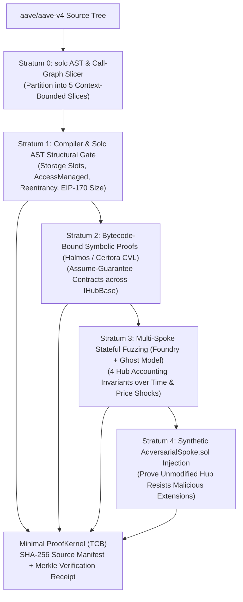

# Verification Methodology for Aave V4: Context-Sliced Assume-Guarantee Proofs

> Companion to the interactive **[Aave V4 Architecture Explorer](https://fredluv.github.io/aave-v4-verification-architecture/)** ([`index.html`](./index.html)). This report focuses strictly on **verification methodology**: how to verify [`aave/aave-v4`](https://github.com/aave/aave-v4) without falling into symbolic path explosion, spec-to-bytecode drift, or LLM/auditor context-window overflow.

---

## 1. The Core Verification Challenge in Aave V4

Aave V4 already ships three verification layers:
1. **Foundry unit & contract suites** across [`tests/contracts/`](https://github.com/aave/aave-v4/tree/main/tests/contracts).
2. **Standalone Python Z3 SMT scripts** under [`tests/misc/z3/`](https://github.com/aave/aave-v4/tree/main/tests/misc/z3) (e.g., [`debt_to_liquidate.py`](https://github.com/aave/aave-v4/blob/main/tests/misc/z3/debt_to_liquidate.py)) and algebraic Python checks like [`supply_share_price_deficit.py`](https://github.com/aave/aave-v4/blob/main/tests/misc/supply_share_price_deficit.py).
3. **Point-in-time Certora formal verification reports** in [`audits/`](https://github.com/aave/aave-v4/tree/main/audits) (`Hub`, `Libraries`, `Spoke`, `TokenizationSpoke`, `Config and Deploy Engine`).

That stack leaves three concrete gaps when verifying the protocol continuously:

| Gap | Where It Bites Aave V4 |
|---|---|
| **Spec-to-Bytecode Drift** | [`tests/misc/z3/`](https://github.com/aave/aave-v4/tree/main/tests/misc/z3) proves idealized formulas written in Python (`commons.py`), **not** the compiled Solidity bytecode of [`SharesMath.sol`](https://github.com/aave/aave-v4/blob/main/src/hub/libraries/SharesMath.sol#L10) or [`LiquidationLogic.sol`](https://github.com/aave/aave-v4/blob/main/src/spoke/libraries/LiquidationLogic.sol#L21). A rounding change or overflow guard in `.sol` leaves the Python Z3 proof green. |
| **State & Context Explosion** | Linking [`Hub.sol`](https://github.com/aave/aave-v4/blob/main/src/hub/Hub.sol#L21) + [`Spoke.sol`](https://github.com/aave/aave-v4/blob/main/src/spoke/Spoke.sol#L33) + [`BabylonSpoke.sol`](https://github.com/aave/aave-v4/blob/main/src/spoke/BabylonSpoke.sol#L18) + [`AaveV4ConfigEngine.sol`](https://github.com/aave/aave-v4/blob/main/src/config-engine/AaveV4ConfigEngine.sol#L14) + Gateways into one monolithic symbolic query blows out SMT solvers and LLM/human review context windows alike. |
| **Future Spoke Extensibility** | Aave V4 promises that new Spokes (`BabylonSpoke`, `TokenizationSpoke`, future RWA/LP Spokes) can be added over time without compromising the immutable Hub. Unit tests only verify *today's* Spokes—not arbitrary future Spokes. |

---

## 2. Chosen Method: Assume-Guarantee Compositional Verification + Synthetic Adversarial Spoke Injection

Rather than proving the whole repository at once, we align the verification boundary with **Aave V4's own trust boundary**: [`IHubBase.sol`](https://github.com/aave/aave-v4/blob/main/src/hub/interfaces/IHubBase.sol#L7).

### Stratum 0 — Deterministic Interface-Boundary Slicing (Context-Window Control)

Before any symbolic engine or LLM assistant inspects a property, `solc --ast-compact-json` + call/storage graph extraction partitions the repository along [`IHubBase.sol`](https://github.com/aave/aave-v4/blob/main/src/hub/interfaces/IHubBase.sol#L7) into **five isolated verification slices**:

| Slice | Exact Modules Included | Cross-Boundary Context Stub | Target Proof Scope |
|---|---|---|---|
| **1. Pure Math & Liquidation** | [`WadRayMath.sol`](https://github.com/aave/aave-v4/blob/main/src/libraries/math/WadRayMath.sol), [`SharesMath.sol`](https://github.com/aave/aave-v4/blob/main/src/hub/libraries/SharesMath.sol#L10), [`Premium.sol`](https://github.com/aave/aave-v4/blob/main/src/hub/libraries/Premium.sol#L9), [`LiquidationLogic.sol`](https://github.com/aave/aave-v4/blob/main/src/spoke/libraries/LiquidationLogic.sol#L21) | None (pure/storage-local functions) | Exact fixed-point rounding direction & dust math directly on bytecode |
| **2. Hub Core** | [`Hub.sol`](https://github.com/aave/aave-v4/blob/main/src/hub/Hub.sol#L21), [`HubStorage.sol`](https://github.com/aave/aave-v4/blob/main/src/hub/HubStorage.sol), [`AssetLogic.sol`](https://github.com/aave/aave-v4/blob/main/src/hub/libraries/AssetLogic.sol#L16), [`AssetInterestRateStrategy.sol`](https://github.com/aave/aave-v4/blob/main/src/hub/AssetInterestRateStrategy.sol#L14) | Arbitrary adversarial `ISpoke` caller + stubbed reinvestment | Hub solvency, cap enforcement, index monotonicity |
| **3. Spoke Risk & Pricing** | [`Spoke.sol`](https://github.com/aave/aave-v4/blob/main/src/spoke/Spoke.sol#L33), `AaveOracle.sol`, `PositionStatusMap.sol`, `ReserveFlagsMap.sol` | Abstracted `IHubBase` summary axioms | Greedy `RP_u` sorting, `dynamicConfigKey` safe rebinding, HF guards |
| **4. Spoke Variants & Gateways** | [`BabylonSpoke.sol`](https://github.com/aave/aave-v4/blob/main/src/spoke/BabylonSpoke.sol#L18), [`BabylonLiquidationLogic.sol`](https://github.com/aave/aave-v4/blob/main/src/spoke/libraries/BabylonLiquidationLogic.sol#L22), [`TokenizationSpoke.sol`](https://github.com/aave/aave-v4/blob/main/src/spoke/TokenizationSpoke.sol#L18), [`SignatureGateway.sol`](https://github.com/aave/aave-v4/blob/main/src/position-manager/SignatureGateway.sol#L16) | `IHubBase` / `ISpoke` interfaces only | Restriction invariants (single reserve, manager-only liquidation, EIP-712 nonces) |
| **5. Config & Governance** | [`AaveV4ConfigEngine.sol`](https://github.com/aave/aave-v4/blob/main/src/config-engine/AaveV4ConfigEngine.sol#L14), [`AccessManagerEnumerable.sol`](https://github.com/aave/aave-v4/blob/main/src/access/AccessManagerEnumerable.sol) | Target `IHub` / `ISpoke` setter signatures | `onlyDelegateCall`, role separation, cap/risk parameter bounds |

> [!TIP]
> **Why slicing matters for LLM-assisted auditing & spec generation:** Each slice fits cleanly inside a small, self-contained context bundle (full `.sol` only for the active slice + interface signatures for neighbors), eliminating attention dilution and keeping CI re-verification strictly incremental per changed PR slice.

---

### Stratum 1 — Compiler & `solc` AST Structural Gate

Borrowing the compiler-AST discipline of `OOPProof-Java`, automated AST visitors enforce architectural rules that runtime tests never check:
1. **Hub Immutability Guard**: Assert [`Hub.sol`](https://github.com/aave/aave-v4/blob/main/src/hub/Hub.sol#L21) / [`HubInstance.sol`](https://github.com/aave/aave-v4/blob/main/src/hub/instances/HubInstance.sol#L9) contain zero `delegatecall` instructions and zero `selfdestruct`.
2. **Spoke Storage Upgrade Compatibility**: Diff `solc --storage-layout` across upgrades to `SpokeStorage.sol` and [`BabylonSpoke.sol`](https://github.com/aave/aave-v4/blob/main/src/spoke/BabylonSpoke.sol#L18) so appended variables never collide with inherited slots.
3. **Mandatory Guard Modifiers**: Walk every `external` / `public` state-mutating function AST node in [`Spoke.sol`](https://github.com/aave/aave-v4/blob/main/src/spoke/Spoke.sol#L33) and [`Hub.sol`](https://github.com/aave/aave-v4/blob/main/src/hub/Hub.sol#L21) to prove uniform coverage of `nonReentrant` (via OpenZeppelin `ReentrancyGuardTransient`) or `restricted` (`AccessManaged`).
4. **Directional Rounding Enforcement**: Flag any raw integer division `/` in share/asset conversion paths outside audited [`SharesMath.sol`](https://github.com/aave/aave-v4/blob/main/src/hub/libraries/SharesMath.sol#L10) and `WadRayMath.sol` helpers (`toSharesDown`, `toSharesUp`, `toAssetsDown`, `toAssetsUp`).

---

### Stratum 2 — Bytecode-Bound Symbolic Verification (Assume-Guarantee via Halmos / Certora CVL)

We close the Python-to-Solidity gap by running symbolic proofs directly against compiled EVM bytecode:

1. **Direct Bytecode Verification of Math & Liquidation Specs**:
   - Port the claims in [`tests/misc/z3/debt_to_liquidate.py`](https://github.com/aave/aave-v4/blob/main/tests/misc/z3/debt_to_liquidate.py) and [`share_assets_conversion.py`](https://github.com/aave/aave-v4/blob/main/tests/misc/share_assets_conversion.py) into **Halmos (`check_*`) / Certora CVL rules** executed directly against [`SharesMath.sol`](https://github.com/aave/aave-v4/blob/main/src/hub/libraries/SharesMath.sol#L17), [`Premium.sol`](https://github.com/aave/aave-v4/blob/main/src/hub/libraries/Premium.sol#L17), and [`LiquidationLogic.sol`](https://github.com/aave/aave-v4/blob/main/src/spoke/libraries/LiquidationLogic.sol#L194).
   - Keep the existing Python Z3 scripts as an **independent specification cross-check**, not the sole proof.
2. **Assume-Guarantee Rule Split**:
   - **Hub Guarantee (Assuming *Unbounded* Spoke Callers within Caps)**: Symbolically prove across [`Hub.add`](https://github.com/aave/aave-v4/blob/main/src/hub/Hub.sol#L200), [`remove`](https://github.com/aave/aave-v4/blob/main/src/hub/Hub.sol#L224), [`draw`](https://github.com/aave/aave-v4/blob/main/src/hub/Hub.sol#L249), [`restore`](https://github.com/aave/aave-v4/blob/main/src/hub/Hub.sol#L274), [`refreshPremium`](https://github.com/aave/aave-v4/blob/main/src/hub/Hub.sol#L362), and [`eliminateDeficit`](https://github.com/aave/aave-v4/blob/main/src/hub/Hub.sol#L333) that:
     - `totalBorrowedShares == sum(spokeDebtShares)`
     - `hubAddedAssets >= sum(spokeAddedAssets)`
     - `hubAddedShares == sum(spokeAddedShares)`
     - `supplySharePrice` and `drawnIndex` never decrease (unless an explicit governed `reportDeficit` / bad-debt path dictates expected bounds).
   - **Spoke Guarantee (Assuming Summarized `IHubBase` Axioms)**: Replace internal `Hub` storage traversal with concise relational pre/post-conditions on `IHubBase`, letting the solver explore 100% of paths inside [`Spoke.borrow`](https://github.com/aave/aave-v4/blob/main/src/spoke/Spoke.sol#L277), `setUsingAsCollateral`, `updateUserRiskPremium`, and `LiquidationLogic.liquidateUser` without timing out.

---

### Stratum 3 — Multi-Spoke Stateful Fuzzing + Differential Ghost Model (Foundry)

Symbolic solvers alone struggle with multi-block time accrual + unbounded dynamic arrays + cross-Spoke interactions. Foundry stateful invariant campaigns bridge that gap:

- **Multi-Spoke Environment**: Deploy **1 real `HubInstance` + 3 concurrent Spokes** (`SpokeInstance`, `BabylonSpokeInstance`, `TokenizationSpokeInstance`) + `AaveV4ConfigEngine` + randomized time jumps + adversarial oracle price swings (`AaveOracle`).
- **Continuous Cross-Spoke Properties Checked After Every Transaction**:
  - All 4 accounting invariants from [`docs/overview.md`](https://github.com/aave/aave-v4/blob/main/docs/overview.md#hub).
  - **Blast-Radius Isolation**: Even if Spoke B's oracle crashes or `Spoke B` is halted, Spoke A suppliers can still withdraw within available liquidity and Hub `drawCap` on Spoke B strictly holds.
  - **Dynamic Config Consistency**: No user transaction (`borrow`, `withdraw`, `setUsingAsCollateral`) can escape an unhealthy state by exploiting stale `dynamicConfigKey` bindings, while passive borrowers cannot be griefed into liquidation until rebinding or governor override.
  - **Liquidation Liveness & No Dust Deadlock**: Any position with `HF < 1.0` can always be liquidated down to `TargetHealthFactor` or full debt clearance (`DUST_LIQUIDATION_THRESHOLD = 1_000` USD), including via `receiveShares = true` at 100% utilization.

---

### Stratum 4 — Synthetic Adversarial Spoke Injection & Proof Kernel Receipt

The defining promise of Aave V4 is **safe future extensibility**: deploying new Spokes should never compromise the Hub.

- **Synthetic Client Extension (`AdversarialSpoke.sol`)**: Automatically synthesize, compile, and wire a brand-new contract implementing the Spoke call surface against the **unmodified [`Hub.sol`](https://github.com/aave/aave-v4/blob/main/src/hub/Hub.sol#L21)**. Drive it with worst-case sequences:
  - Attempting to `draw` past `drawCap` or when `halted`.
  - Submitting pathological `PremiumDelta` payloads to `Hub.refreshPremium` exceeding `riskPremiumThreshold`.
  - Interleaving `reportDeficit` and `eliminateDeficit` during active vs. halted states.
  - Dust-amount `add`/`remove`/`restore` loops hunting 1-wei share inflation.
- **Minimal Trusted Computing Base (`ProofKernel`)**: Collect SHA-256 hashes of all verified `.sol` files, `solc --ast-compact-json` structural check logs, Halmos/Certora UNSAT proofs, and Foundry invariant run summaries into a **commit-pinned Merkle Proof Certificate**. If any upstream contract changes, only invalidated slices re-run.

---

## 3. Why This Method Wins

| Approach | Fatal Weakness on Aave V4 | How Context-Sliced Assume-Guarantee Verification Fixes It |
|---|---|---|
| **Foundry Unit Tests Only** | Checks developer-imagined scenarios; misses subtle 1-wei rounding leaks in [`SharesMath`](https://github.com/aave/aave-v4/blob/main/src/hub/libraries/SharesMath.sol#L17), dusty multi-collateral liquidations, and `refreshPremium` + `dynamicConfigKey` race sequences. | Exhaustive **bytecode symbolic proofs** cover all numerical inputs in slices, while **stateful multi-Spoke fuzzing** explores thousands of randomized action interleavings. |
| **Python-Only Z3 Proofs** (`tests/misc/z3/`) | Proves a hand-written Python model (`debt_to_liquidate.py`), leaving a silent **semantic gap** vs. deployed EVM bytecode. | Binds SMT/symbolic verification directly to **compiled Solidity (`Halmos` / `Certora`)** and treats Python Z3 scripts as an independent reference oracle. |
| **Un-sliced Monolithic Verification** | Whole-protocol symbolic state explodes across Hub + multiple Spokes + Gateways + ConfigEngine, causing solver timeouts and LLM/auditor context rot. | Exploits `IHubBase` as an **Assume-Guarantee cut**: verifies Hub against abstract bounded Spokes and each Spoke against `IHubBase` axioms in compact, bounded context slices. |
| **Static Audit PDFs Only** | Audits (`audits/*.pdf`) freeze at one commit; subsequent Spoke additions (`BabylonSpoke`, `TokenizationSpoke`) risk breaking assumptions silently. | Runs **incrementally per PR slice in CI** and injects **`AdversarialSpoke.sol`** directly against unmodified `Hub.sol`, proving extensibility bounds continuously. |
